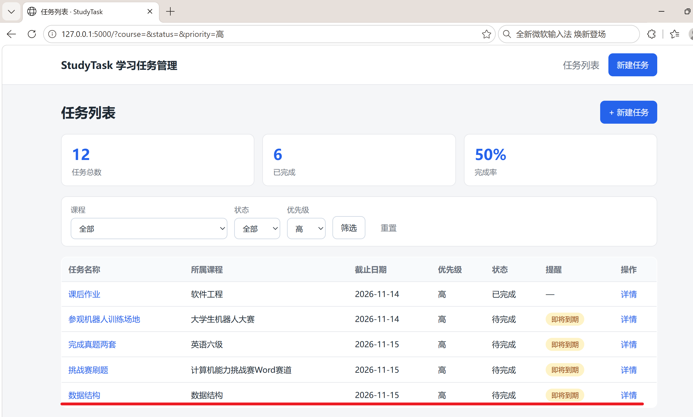
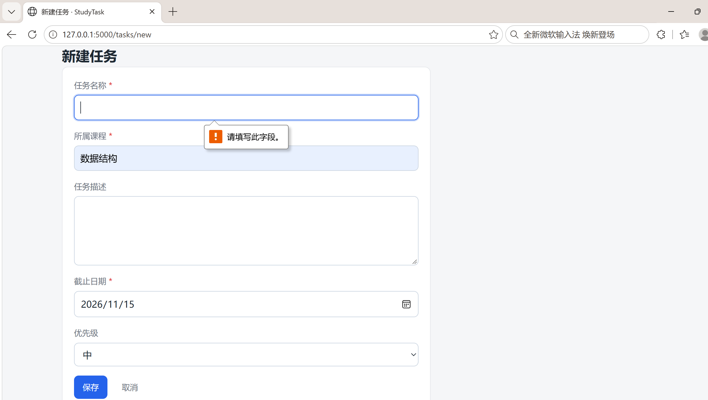
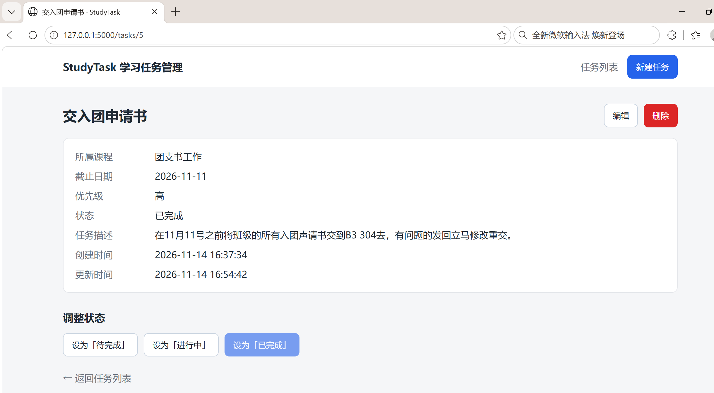
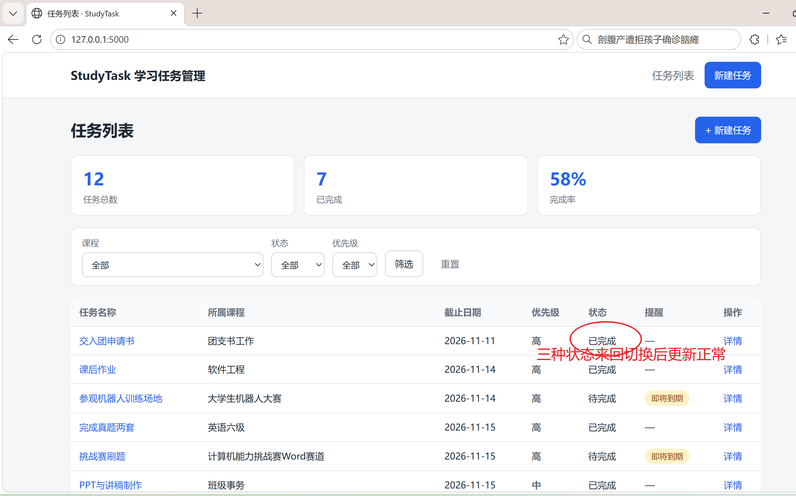
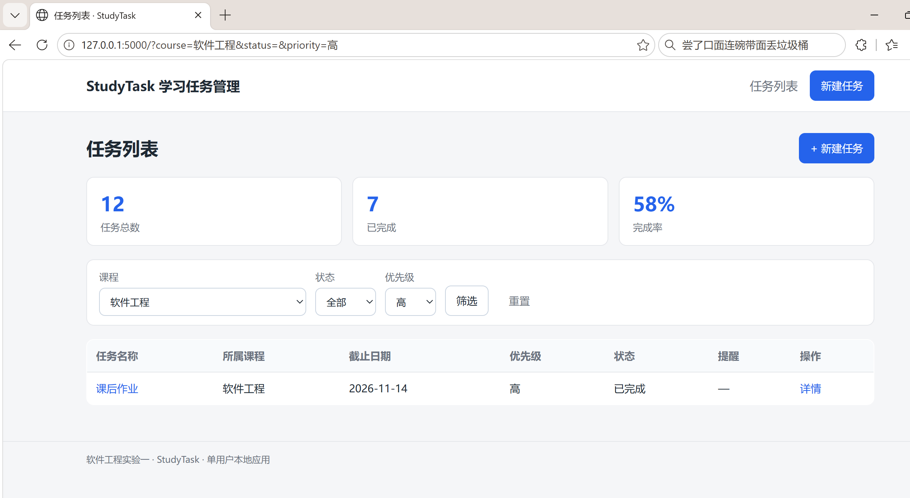
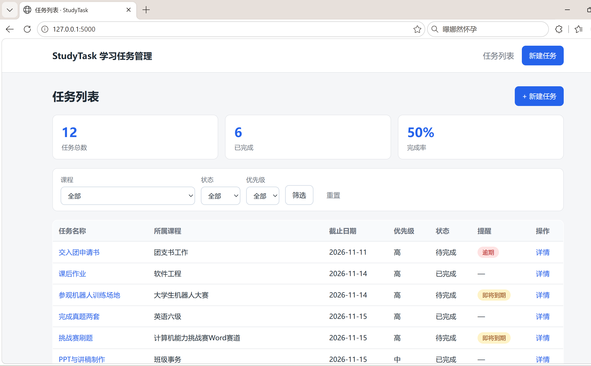
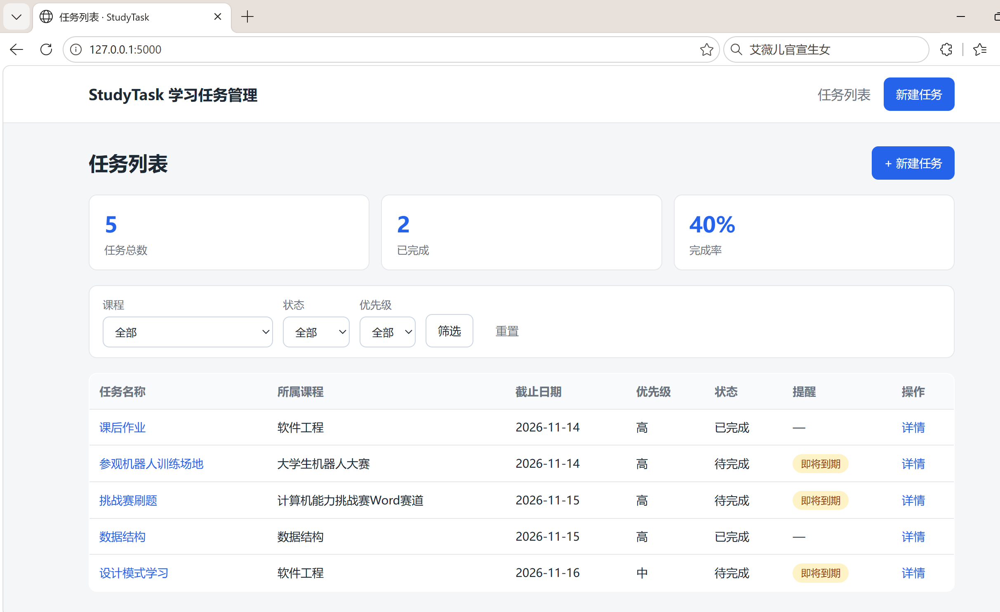
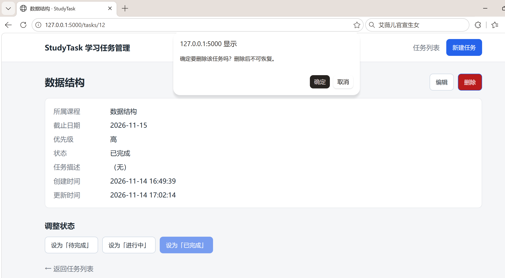
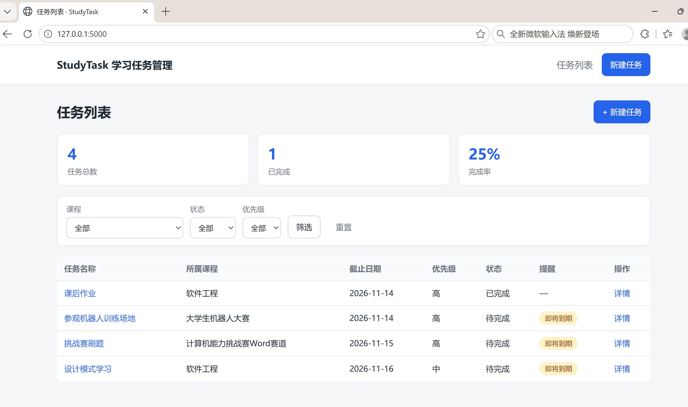

# 验收记录 · StudyTask（T1–T10）

> 用法：按 README 启动应用后逐条执行；每条填写实际结果、证据（截图文件名 / 命令输出）与是否通过。
> 这份记录是实验一提交材料「需求验收表」的正文，禁止只写“通过”而无证据。

- 验收人：杨肇金
- 验收日期：2026-11-14
- 运行环境：Windows；浏览器：Microsoft Edge
- 启动命令：`python app.py`，访问地址：<http://127.0.0.1:5000>
- 自动化测试：初验 20 passed；缺陷修复后 25 passed

| 用例 | 需求 | 操作 / 输入 | 预期结果 | 实际结果 | 证据 | 是否通过 |
| --- | --- | --- | --- | --- | --- | --- |
| T1 | FR-01 | 新建：课程“数据结构”、明天截止、高优先级 | 列表显示新增任务 | 列表显示了新的任务 |  | 是 |
| T2 | FR-01 | 名称为空提交新任务 | 提示错误，不产生脏数据 | 提示错误：请输入任务名称，并且没有产生脏数据 |  | 是 |
| T3 | FR-03 | 修改任务描述与优先级 | 修改成功且刷新后保留 | 修改成功并且刷新后保留 |  | 是 |
| T4 | FR-05 | 待完成 → 进行中 → 已完成 | 状态逐次正确更新 | 状态逐次正确更新 |  | 是 |
| T5 | FR-06 | 分别筛选课程、状态和优先级（含组合） | 结果只包含匹配任务 | 结果只包含匹配任务 |  | 是 |
| T6 | FR-07 | 新增昨日到期且未完成的任务 | 显示逾期标识 | 显示逾期标识 |  | 是 |
| T7 | FR-07 | 新增明日到期且未完成的任务 | 显示即将到期标识 | 显示即将到期标志 |  | 是 |
| T8 | FR-08 | 创建 5 项、完成 2 项 | 总数 5、完成数 2、完成率 40% | 总数 5、完成数 2、完成率 40% |  | 是 |
| T9 | FR-04 | 删除一项任务，先取消再确认 | 取消不删除、确认后删除 | 取消不删除、确认后删除 |  | 是 |
| T10 | FR-09 | 关闭并重新启动系统 | 已保存数据仍可查询 | 已保存的数据仍可查询 |  | 是 |

## 验收中发现的问题

T1–T10 全部通过；此外验收中发现以下 3 个缺陷，均已修复并补充自动化测试。每个问题都已同步写入 `AI_DEV_LOG.md`。

| 编号 | 复现步骤 | 实际表现 | 期望表现 | 修复状态 |
| --- | --- | --- | --- | --- |
| D-01 | 新建任务时，提交与已有任务完全相同的记录（名称、课程、描述、截止日期、优先级一致） | 重复记录创建成功，产生冗余数据 | 应拦截并提示，不产生重复记录 | 已修复：新建前查重，命中时提示“已存在完全相同的任务”；提交按钮防重复点击。已复验 |
| D-02 | 任务名称 / 所属课程输入超长内容（或粘贴超长文本） | 浏览器 `maxlength` 静默截断，任务仍被创建，用户无感知 | 应明确提示超长且不创建 | 已修复：移除 `maxlength`，增加实时字数提示；服务端超限拒绝并显示错误。已复验 |
| D-03 | 新建名称 / 课程很长的任务后查看列表 | 长文本撑破单元格，换行错乱、文字溢出、表格布局变形 | 单元格内自动换行，整体布局不变形 | 已修复：`table-layout: fixed` + `overflow-wrap: anywhere` / `word-break: break-word`，详情页同步处理。已复验 |

## 开发阶段问题与修复记录（非验收发现，供实验报告引用）

> 说明：以下两个问题发生在 AI 生成初版的过程中，均已在初版提交（`d3bbe71`）前修复，**不属于本轮人工验收新发现的缺陷**；单独记录以保留真实修复过程，避免与验收表混淆。

| 编号 | 问题现象 | 原因 | 修复方式 | 验证证据 | 状态 |
| --- | --- | --- | --- | --- | --- |
| DEV-01 | 新建任务路由误写为 `/tasks`，16 条测试返回 404 | 路由地址与测试约定不一致（表单提交地址为 `/tasks/new`） | 创建路由统一为 `/tasks/new`，表单 action 与测试用例同步修改 | `python -m pytest -q` → 20 passed；`app.py` 路由确认包含 `/tasks/new` | 已修复（初版前） |
| DEV-02 | pytest 的 `tmp_path` 临时目录在当前运行环境权限异常，测试无法执行 | 测试默认使用系统临时目录，受运行环境权限限制 | 测试临时数据库改到项目内 `tests/_tmp`；新增 `pytest.ini` 限定 `testpaths = tests` | `pytest.ini` 生效、`tests/_tmp` 可用；`python -m pytest -q` → 20 passed | 已修复（初版前） |

> 对验收的影响：无。两问题均在初版提交前解决，因此 T1–T10 的人工验收基于已修复版本。
